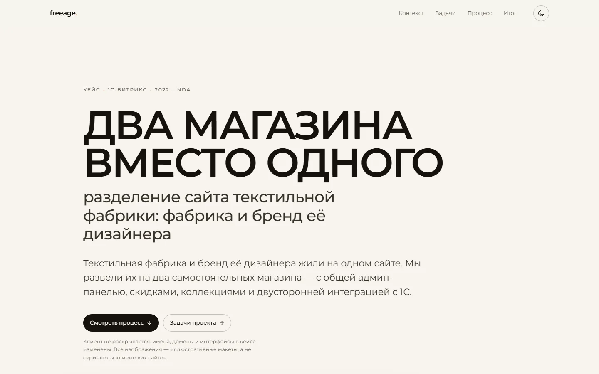
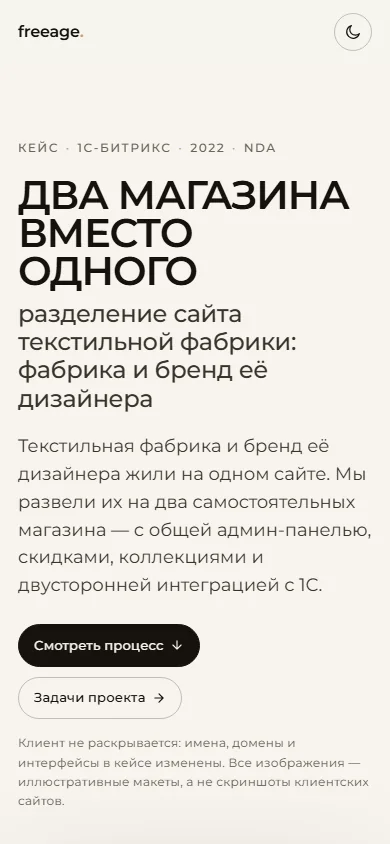

<p align="center">
  <picture>
    <source media="(prefers-color-scheme: dark)" srcset="docs/preview-dark.webp">
    
  </picture>
</p>

<h1 align="center">Два магазина вместо одного · кейс</h1>

<p align="center">
  Как один сайт текстильной фабрики стал двумя — с общей админ-панелью,<br>
  скидками, коллекциями, лукбуком и двусторонней интеграцией с 1С.
</p>

<p align="center">
  <a href="https://freeage3.vercel.app">
    
  </a>
</p>

<p align="center">
  
  
  
  
  
</p>

---

## О проекте

В 2022 году мы развели один сайт текстильной фабрики на два самостоятельных
интернет-магазина: магазин фабрики и магазин бренда её дизайнера. Задача была не
только в вёрстке: нужно было сохранить админ-панель 1С-Битрикс, функционал скидок
и коллекций, сделать нестандартную корзину, лукбук с галереей и двусторонний
обмен с 1С по заказам, остаткам и товарам.

Это страница-кейс об этой работе — переписанная с нуля в 2026 году.

| | |
|:--|:--|
| **Платформа** | 1С-Битрикс |
| **Роль** | разработка, интеграция, техподдержка |
| **Год запуска** | 2022 |
| **Результат** | 2 интернет-магазина, общая админ-панель, обмен с 1С |

### Анонимизация

Клиент не раскрывается: имена, названия брендов и домены изменены. Снимки
клиентских сайтов в кейсе не используются — все изображения собраны как
иллюстративные HTML-макеты (`tools/mockups/`) и не содержат данных клиента.
Демонстрационные магазины в макетах — `ATELIER` (бренд) и `MANUFAKTURA` (фабрика).
Исходные снимки 2022 года в публичную версию не входят.

Если для отклика нужны настоящие материалы проекта, они передаются по запросу.

### Демо

- Продакшен: **[freeage3.vercel.app](https://freeage3.vercel.app)**

---

## Скриншоты

<p align="center">
  
</p>

---

## Что внутри

**Дизайн и вёрстка**

- редакционная сетка кейс-стади: крупный типографический hero, нумерованные
  секции, липкое оглавление с прогрессом чтения;
- «жидкая» типографика на `clamp()` — от 320 до 2560 px без ломки масштаба;
- светлая и тёмная темы: системная по умолчанию и ручной переключатель
  с запоминанием выбора (без вспышки при загрузке);
- блочные изображения с подписями, «браузерные» рамки у макетов, схема
  интеграции на CSS-сетке.

**Скорость**

- hero-скриншоты: PNG 517 КБ → **AVIF 13 КБ / WebP 22 КБ**, `srcset` и `sizes`;
- экранный тур: GIF 6,9 МБ → **анимированный WebP 219 КБ** с кроссфейдами,
  ленивая загрузка;
- Montserrat в woff2 (кириллица + латиница) — **60 КБ и ноль внешних запросов**;
- первый экран ≈ 135 КБ, весь сайт ≈ 1,0 МБ.

**Доступность**

- скип-линк, корректные лендмарки и порядок заголовков;
- `:focus-visible`, осмысленные `alt`, `prefers-reduced-motion`;
- контраст текста не ниже AA в обеих темах.

**SEO и метаданные**

- title, description, Open Graph и Twitter Card с собственной OG-картинкой;
- canonical, [sitemap.xml](sitemap.xml), [robots.txt](robots.txt),
  [SVG-favicon](assets/favicon.svg) и apple-touch-icon.

**Прогрессивное улучшение**

- тема, оглавление, появление блоков и прогресс чтения — опциональный слой
  в [5 КБ JS](assets/js/app.js);
- без JavaScript страница полностью читается и выглядит как задумано.

---

## До и после

| | 2022, v1 | 2026, v2 |
|:--|:--|:--|
| Вес страницы | ~7 МБ | ~1,0 МБ (первый экран ≈ 135 КБ) |
| Главный тяжёлый файл | GIF 6,9 МБ | WebP 219 КБ |
| Шрифты | Google Fonts, внешний запрос | локальные woff2 |
| JS | webpack-бандл с пустой точкой входа | 5 КБ без зависимостей |
| Метаданные | `<title>Document</title>` | title, description, OG, sitemap |
| Темы | нет | светлая и тёмная |
| Адаптив | один брейкпоинт | 320–2560 px |
| Сборка | только собранные файлы | исходники как есть, сборки нет |

---

## Структура

```
.
├── index.html                 разметка кейса
├── assets/
│   ├── css/style.css          токены, темы, адаптив (~22 КБ)
│   ├── js/app.js              тема, прогресс, оглавление, reveal (~5 КБ)
│   ├── fonts/                 Montserrat, переменный, два сабсета
│   ├── img/                   AVIF/WebP/JPG, готовые к отдаче
│   ├── favicon.svg
│   └── apple-touch-icon.png
├── tools/
│   ├── build_assets.py        макеты → AVIF/WebP, OG и превью
│   ├── mockups/               HTML-макеты экранов и общий CSS
│   ├── og-card.html           макет OG-картинки 1200×630
│   └── icon.html              макет иконки
├── docs/                      превью для этого README
├── robots.txt
├── sitemap.xml
└── vercel.json                кэш и security-заголовки
```

---

## Быстрый старт

Сборка не нужна — достаточно любого статического сервера из корня проекта:

```bash
git clone https://github.com/AlexMerf/freeage3.git
cd freeage3

python -m http.server 5173
# или
npx serve .
```

Открыть <http://localhost:5173>.

### Пересборка изображений

```bash
python tools/build_assets.py
```

Скрипт рендерит страницы из `tools/mockups/` headless-браузером, собирает
анимированный тур, OG-картинку и превью для README, а затем кодирует всё в
AVIF/WebP с сохранением пропорций — поэтому `width`/`height` в разметке остаются
честными и страница не «прыгает».

Нужны Pillow с поддержкой AVIF и Chrome или Edge. Путь к браузеру можно задать
переменной `CHROME_PATH`.

### Деплой

Vercel раздаёт папку как статику:

```bash
vercel --prod
```

`vercel.json` задаёт заголовки кеширования для шрифтов и ассетов и базовые
security-заголовки.

---

## История

- **2022, v1** — gulp/webpack-стартер, в репозиторий попадали только собранные
  файлы.
- **2026, v2** — страница переписана с нуля: своя вёрстка, темы, адаптив,
  оптимизированные изображения, доступность, SEO. Сборки больше нет.
- **2026, анонимизация** — имена клиента и брендов убраны, реальные скриншоты
  заменены иллюстративными макетами, которые собираются из HTML.

---

<p align="center"><sub>Сделано в 2022-м. Переписано с нуля и обезличено в 2026-м.</sub></p>
